Le VPS n'accepte que SSH. Tout le reste passe par une connexion sortante du cluster vers Cloudflare, qui filtre l'accès avant même d'atteindre le serveur.

*Schéma du projet k3s-test : `k3s-lab/assets/architecture.svg`, source Mermaid dans le dépôt k3s-lab.*

Toi, tu administres par SSH ; GitHub et les visiteurs passent par Cloudflare. Chaque bande du cluster se rejoue seule avec la commande indiquée à droite.

| Brique | Choix | Pourquoi |
| --- | --- | --- |
| Provisioning | Ansible | Idempotent, réutilisable tel quel d'un serveur à l'autre |
| Distribution | k3s v1.34 (SQLite, Traefik interne, sans ServiceLB) | Binaire unique, aucun port publié sur l'IP, version acceptée par Rancher |
| Entrée publique | Cloudflare Tunnel (cloudflared dans le cluster) | Zéro port web ouvert, TLS géré par Cloudflare, pas de cert-manager |
| Contrôle d'accès | Cloudflare Access | Email pour Rancher et Grafana, jeton de service pour l'API |
| Déploiement | Helmfile, versions exactes suivies par Renovate, profils de taille | Couches sélectionnables, versions figées, `diff` avant `apply`, même code pour toutes les machines |
| PostgreSQL | CloudNativePG | Bases déclaratives, seed rejouable, métriques Prometheus |
| Fichiers publics | OVH Object Storage (S3) + proxy nginx + cache Cloudflare | Hors du serveur, trafic sortant gratuit, servi depuis le domaine du projet et mis en cache |
| Observabilité | kube-prometheus-stack (Grafana), Loki + Alloy, Rancher | Métriques, logs et tableaux de bord dans Grafana, interface de diagnostic |
| Accès CI | OIDC GitHub Actions + RBAC par namespace | Aucun jeton Kubernetes stocké chez GitHub, droits limités à un namespace |
| Secrets | SOPS + age | Chiffrés dans Git, déchiffrés à la volée par helm-secrets |

**Noms d'hôtes.** Le certificat gratuit de Cloudflare couvre `*.<zone>`, pas `*.k3s.<zone>`. Tous les noms restent donc à un niveau, avec le suffixe du projet : `rancher-test`, `grafana-test`, `whoami-test`, `k8s-api-test` pour k3s-test. Le CNAME joker `*` vers le tunnel du premier projet de la zone couvre tout nouveau service sans action dans Cloudflare ; les projets suivants déclarent leurs noms un par un.

**Routage du tunnel** (`helmfile/values/cloudflared.yaml.gotmpl`) : `k8s-api<suffixe>` va vers l'API Kubernetes en TCP, tout le reste de la zone vers Traefik.

**Réglages de zone** : SSL/TLS, Edge Certificates, **Always Use HTTPS** activé et version TLS minimale 1.2.

**Poste, Cloudflare et WARP** se configurent une fois, dans la [Mise en route](/k3s-lab/mise-en-route) ; tunnel, route, DNS et applications Access une fois par projet. Tous survivent aux reconstructions du cluster.

**Un modèle, des projets.** `k3s-lab` est un dépôt modèle ; chaque projet en est une copie qui ne diffère que par `environments/`. Une évolution du code commun se fait dans le modèle, puis se reporte dans les projets ([Créer un projet](/k3s-lab/nouveau-projet)).
